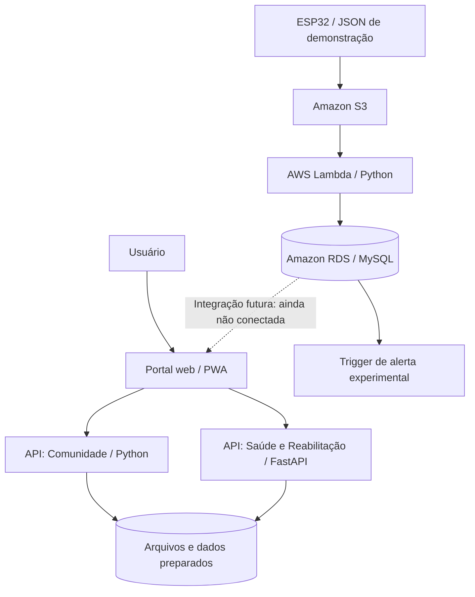
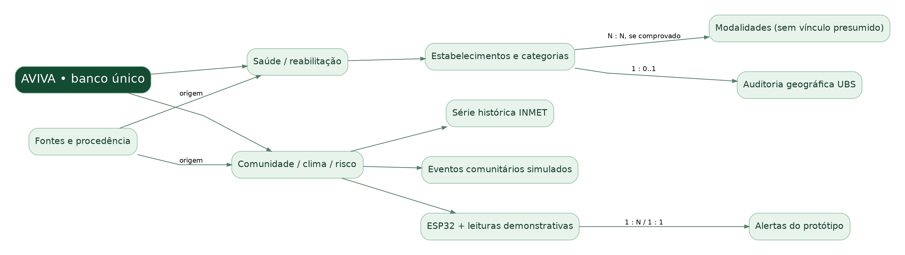

# AVIVA — Inteligência para comunidades e acesso a serviços

[](https://github.com/CaioNicolav/Aviva-platform/actions/workflows/ci.yml)


**Plataforma web de informação territorial, apoio comunitário e orientação sobre serviços de saúde e reabilitação.** O AVIVA reúne interfaces responsivas, APIs em Python, tratamento de dados públicos, análise de eventos e um pipeline em nuvem para ingestão de medições IoT simuladas.

**Desenvolvimento:** Caio Nicolav e Leonardo da Silva  
**Status:** projeto real em evolução, com protótipos funcionais e integrações técnicas validadas em ambiente de testes. **Não é um serviço de emergência ou assistência clínica em produção.**

## Visão do produto

O AVIVA busca ajudar cidadãos a explorar informações territoriais e serviços disponíveis, com foco em navegação acessível, transparência sobre a origem dos dados e recomendações que sinalizam incerteza. O trabalho é dividido em três frentes:

- **Comunidade e território:** distrito, contexto climático, equipamentos locais e mural de demonstração.
- **Saúde e reabilitação:** busca de estabelecimentos cadastrados, mapa com localizações verificadas e orientações de acesso à rede pública.
- **Infraestrutura e dados:** modelagem MySQL, ingestão experimental de medições IoT com AWS S3 → Lambda → RDS e alertas SQL de teste.

## Arquitetura



**Importante:** o fluxo AWS foi testado isoladamente e não é apresentado como fonte de dados já conectada ao portal. Alertas e medições demonstrativos não devem ser usados para decisões de risco real.

## Stack técnica

`Python` · `FastAPI` · `JavaScript` · `HTML5` · `CSS3` · `MySQL` · `SQL` · `AWS S3` · `AWS Lambda` · `Amazon RDS` · `CloudWatch` · `PWA` · `Pytest` · `Git`

## Componentes e comprovação

| Componente | Implementação e evidência | Limite atual |
|---|---|---|
| Portal integrado | `portal.py`, navegação entre módulos, front-end responsivo | Login demonstrativo; sem autenticação real |
| Comunidade | Monitor, dados climáticos e interface territorial | Exemplos comunitários simulados, ML exploratório |
| Saúde e reabilitação | API FastAPI, pesquisa, mapa baseado em validação geográfica | Presença no cadastro não garante atendimento |
| Banco MySQL | 14 tabelas e 16 relacionamentos, SQL de carga e auditoria | O site ainda não consulta essa base |
| AWS IoT | S3 → Lambda → RDS → trigger SQL comprovado em 19/11/2026 | Dados e dispositivo simulados; execução não verificada agora |
| Machine Learning | Notebooks e pipelines experimentais | Não é um modelo de previsão operacional implantado |

## Evidências da implantação AWS

A ingestão testada em **19/11/2026** registrou uma medição simulada de **225 cm** no banco e acionou o **alerta crítico nº 5** por trigger MySQL, sem invocação manual da função. A configuração envolve S3 com prefixo `medicoes/`, Lambda Python 3.12 com PyMySQL, MySQL no Amazon RDS e rede VPC. Ver detalhes em [`docs/IMPLEMENTACAO_AWS.md`](docs/IMPLEMENTACAO_AWS.md).

O código em [`infra/aws/lambda_function.py`](infra/aws/lambda_function.py) é uma **reconstrução de referência baseada na implantação comprovada**, pois o arquivo-fonte integral efetivamente executado na AWS não estava disponível para recuperação. O SQL de correção do trigger foi recuperado de arquivo original.

## Como executar o portal localmente

```powershell
py -m pip install -r requirements.txt
py portal.py --port 8001
```

Abra `http://127.0.0.1:8001/`. Use Python recente compatível com as dependências. **Não execute `uvicorn portal:app`**: a aplicação é montada dinamicamente por `portal.py`.

Para testar a Lambda reconstruída sem AWS:

```bash
python -m unittest discover -s infra/aws/tests -v
```

Para auditoria offline da base:

```bash
python banco-de-dados/testes/testar_integridade_base.py
```

**Testes verificados:** 69 em Comunidade, 71 em Saúde/Reabilitação, 7 na Lambda de referência e auditoria offline da base aprovada. Veja [`docs/TESTES_E_EVIDENCIAS.md`](docs/TESTES_E_EVIDENCIAS.md).

Veja [`docs/EXECUCAO_LOCAL.md`](docs/EXECUCAO_LOCAL.md) para dependências e instalação dos módulos.

## Organização do repositório

```text
aviva/
├── portal.py                      # integração HTTP e rotas do portal
├── site/                         # interface web e PWA
├── modulos/
│   ├── comunidade/               # monitoramento territorial, web, dados e testes
│   └── reabilitacao/             # API e interface de saúde, dados e testes
├── banco-de-dados/
│   ├── sql/                      # schema, carga e consultas originais
│   ├── origens/                  # bases com procedência documentada
│   ├── diagramas/                # MER/DER
│   └── testes/                   # integridade offline
├── iot/                          # firmware ESP32 / Wokwi
├── machine-learning/             # notebooks e experimentos
├── infra/aws/                    # referência Lambda, SQL, evento e testes
└── docs/                         # arquitetura, evidências e limitações
```

## Dados públicos e modelagem

A base exploratória CNES contém **27.779 registros** e está preservada integralmente em cinco partes GZIP, lidas automaticamente pelo módulo Saúde/Reabilitação. A integridade é verificada por SHA-256. Dados INMET históricos e eventos comunitários **sintéticos** também estão versionados. Veja a [documentação dos dados](docs/DADOS_PUBLICOS.md).



## Inventário dos códigos

Veja [`docs/MAPA_DOS_CODIGOS.md`](docs/MAPA_DOS_CODIGOS.md) para localizar os arquivos originais e identificar as referências reconstruídas.

## Autores e responsabilidade

**Caio Nicolav e Leonardo da Silva** — concepção e desenvolvimento colaborativo. A versão pública utiliza um histórico Git novo, sem importar os commits privados anteriores, como precaução de segurança. Atribuições individuais não são inventadas sem evidência no histórico ou confirmação dos autores.

> Este repositório apresenta engenharia de software e dados com transparência sobre o estágio de cada módulo. As fontes públicas devem ter suas licenças e atualizações respeitadas. Não inserir dados pessoais, de pacientes nem credenciais em issues, testes ou demonstrações.