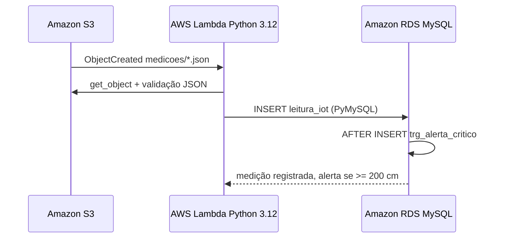

# AVIVA — Implantação AWS e processamento IoT

## Fluxo técnico validado (19/11/2026)

**Arquitetura implementada na demonstração:** bucket S3, Lambda `aviva-processar-medicoes` (Python 3.12), camada PyMySQL, RDS MySQL, VPC/security groups e CloudWatch.

**Evidências da execução anterior:**
- Carregamento do PyMySQL na Lambda, resposta `statusCode: 200`.
- Conexão autenticada ao RDS e consulta a 2.647 estabelecimentos.
- Teste de medição de 210 cm: leitura #4 e alerta #4.
- Upload de JSON ao S3 com medição de 225 cm: leitura #5 e alerta crítico #5 **sem invocação manual**.
- Unicidade do par dispositivo + data/hora relatada na validação.

As medições são simuladas, não leituras de sensores físicos em campo. A integração não equivale a serviço de alerta urbano em produção.

## Código e proveniência

- `infra/aws/lambda_function.py`: **reconstrução técnica de referência**; o arquivo integral da Lambda utilizada em 19/11 não estava disponível nos anexos recuperados.
- `infra/aws/sql/01_trigger_alerta_critico.sql`: trigger recuperado do SQL de correção original.
- `infra/aws/sql/02_unicidade_idempotencia.sql`: migração de **referência** reconstruída a partir da regra descrita nos testes.
- `banco-de-dados/sql/`: scripts SQL originais da modelagem, disponíveis no pacote completo de portfólio.

## Reproduzir em ambiente de testes

1. Crie um banco MySQL 8.x em RDS e o schema `aviva_gs_2026`.
2. Aplique os scripts originais e valide o cadastro `AVIVA-ESP32-DEMO`.
3. Verifique duplicatas **antes** de criar índice UNIQUE por `id_dispositivo,data_hora`.
4. Configure o trigger SQL somente após revisão de backup e estado atual.
5. Implante a Lambda com PyMySQL e acessos IAM mínimos a S3/Secrets Manager/CloudWatch.
6. Use Secrets Manager para credenciais e TLS com certificado RDS; restrinja acesso por VPC/SG.
7. Configure notificação ObjectCreated do S3 em `medicoes/`, envie JSON de teste e verifique os logs.
8. Ao concluir, desligue recursos desnecessários para evitar custos.

Nenhuma credencial, nome de usuário AWS ou endpoint de produção é necessário para reproduzir a arquitetura. **Não usar os alertas experimentais para decisões de segurança.**
